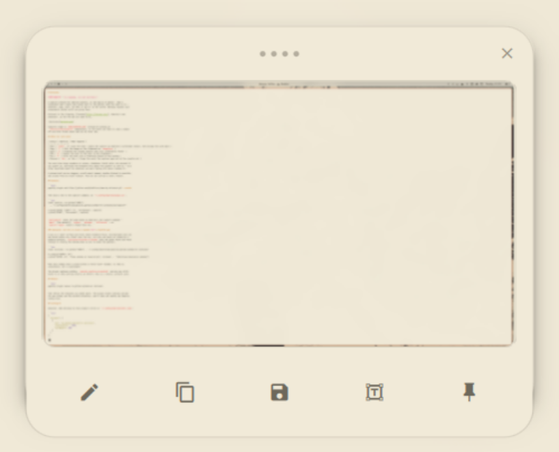

# Kirinuki

**切り抜き** — *a clipping, cut out and kept.*

A capture preview for Omarchy Quattro, in the spirit of Shottr. Take a
screenshot and a small card drops next to the pointer with the shot in it —
annotate, copy, save, run OCR, or pin it to the screen. Nothing touches your
screenshots folder until you press Save.

Kirinuki is the clipping; Omarchy's own annotator (omasnap since Omarchy 4.5,
[Tensaku](https://tensaku.dev/) before it) is the red pen you take to it.

The screen freezes the moment you press the key, so whatever you were hovering
— a tooltip, an open menu, a `:hover` style — is still there in the shot.

Click a window instead of dragging a region and the shot comes back framed, the
way Shottr does it: the window with its rounded corners and a soft shadow,
centred on your current wallpaper with even padding all round.



Captures stage in `$XDG_RUNTIME_DIR` instead of landing in
`~/Pictures/Screenshots` immediately, so the shots you took to read a number
off and then forgot about age out on their own.

## What the card does

| Action | Shortcut | What happens |
| --- | --- | --- |
| Edit | `Enter`, or click the shot | Opens the capture in Omarchy's screenshot editor, then brings the card back |
| Copy | `C` | Puts the image on the clipboard as `image/png` |
| Save | `S` | Promotes the staged capture into your screenshots folder |
| OCR | `O` | Copies the text in the shot to the clipboard |
| Pin | `P` | Turns the shot into a frameless always-on-top window |
| Discard | `Esc`, or the ✕ | Drops the card; the capture ages out of the scratch dir |

The card also drags anywhere on screen, dismisses itself after six seconds if
you ignore it, and holds the keyboard only while the pointer is over it — so a
stray keystroke meant for whatever you were typing into never reaches it.

A pinned shot can be dragged, scroll-wheel zoomed, double-clicked to annotate,
and closed from its hover toolbar. Pins do not survive a shell restart.

## Install

```bash
omarchy plugin add https://github.com/ByteMirror/omarchy-kirinuki.git --enable
```

Then bind a key to the capture command. In `~/.config/hypr/bindings.lua`:

```lua
local capture = os.getenv("HOME")
  .. "/.config/omarchy/plugins/io.github.bytemirror.kirinuki/bin/capture"

o.bind("SUPER + SHIFT + S", "Screenshot", capture)
o.bind("PRINT", "Screenshot", capture)
```

`bin/capture` takes the same modes as Omarchy's own capture command —
`smart` (the default), `region`, `windows`, `fullscreen` — so
`capture region` binds a region-only key.

### Optional: one key to close a window *or* a hovered pin

A pin is a layer surface and never takes keyboard focus, and Hyprland runs its
own binds before any client sees the key, so a pin can never be closed by a
keybind directly. `bin/close-hovered-or-window` asks the panel first and falls
through to closing the window when no pin is under the pointer:

```lua
local kirinuki = os.getenv("HOME") .. "/.config/omarchy/plugins/io.github.bytemirror.kirinuki"

hl.unbind("SUPER + W")
o.bind("SUPER + W", "Close window or hovered pin", kirinuki .. "/bin/close-hovered-or-window")
```

Pins also always have a close button in their hover toolbar, so this is
convenience, not a requirement.

The plugin replaces nothing. `omarchy-capture-screenshot` (omasnap) and any
key still bound to it keep working exactly as before; this is a second,
parallel path.

## Remove

```bash
omarchy plugin remove io.github.bytemirror.kirinuki
```

Then delete the keybinds you added above. The plugin writes nothing outside
its own folder and the scratch directory, and it does not modify any Omarchy
config file.

## Configure

Optional. Add settings to this plugin's entry in `~/.config/omarchy/shell.json`:

```json
{
  "plugins": [
    {
      "id": "io.github.bytemirror.kirinuki",
      "dismissAfter": 8000,
      "cardWidth": 380
    }
  ]
}
```

| Key | Default | Meaning |
| --- | --- | --- |
| `dismissAfter` | `6000` | Milliseconds an untouched card lingers; `0` keeps it up until dismissed |
| `cardWidth` | `340` | Width of the shot inside the card, in logical pixels |
| `maxImageHeight` | `240` | Tallest the shot gets before it stops growing |
| `pinMaxWidth` | `520` | Widest a fresh pin opens |

Environment variables, all optional:

| Variable | Default | Meaning |
| --- | --- | --- |
| `KIRINUKI_JPEG` | `0` | Set to `1` to transcode captures to JPEG |
| `KIRINUKI_JPEG_QUALITY` | `92` | JPEG quality when the above is on |
| `KIRINUKI_STAGING_DIR` | `$XDG_RUNTIME_DIR/kirinuki` | Where captures wait (created private, `0700`) |
| `KIRINUKI_KEEP_MINUTES` | `1440` | Age at which an unsaved capture is dropped |
| `KIRINUKI_WINDOW_FRAME` | `1` | Set to `0` to shoot a clicked window bare, without the wallpaper frame |
| `KIRINUKI_MAX_BYTES` | `67108864` | Largest capture, in bytes, that will be decoded or written |
| `KIRINUKI_MAX_PIXELS` | `80000000` | Largest capture, in pixels, that will be decoded |
| `KIRINUKI_MAX_DIMENSION` | `32768` | Longest side, in pixels, that will be decoded |
| `KIRINUKI_MAX_TEXT_BYTES` | `1048576` | Most OCR text that may reach the clipboard |
| `KIRINUKI_TIMEOUT` | `20` | Seconds any one image or OCR run may take |

Omarchy's own `OMARCHY_SCREENSHOT_DIR`, `OMARCHY_SCREENSHOT_EDITOR` and
`OMARCHY_OCR_LANGS` are honoured as they are; this plugin does not shadow them.

## Dependencies

Everything the plugin runs is listed here.

Shipped with Omarchy Quattro, already present on a stock install:

| Command | Used for |
| --- | --- |
| `slurp` | Selecting a region or window |
| `grim` | Taking the capture |
| `hyprpicker` | Freezing the screen while you select when the shell is not running (the panel holds the freeze otherwise), so hover states are still in the shot |
| `omarchy-shell` | Summoning the panel over the shell's IPC |
| `omarchy-notification-send` | Result notifications |
| `hyprctl` | Pointer position, monitor geometry and window boxes |
| `jq` | Reading Hyprland's JSON and building the summon payload |
| `python3` | `bin/open`, the one place a capture is opened (see below); standard library only |
| `wl-copy` | Clipboard |
| `omasnap` | Annotation — Omarchy 4.5's editor; `tensaku` is used instead where it is still installed, and `OMARCHY_SCREENSHOT_EDITOR` overrides both |

On a stock Omarchy 4.5 install the three below are present too (`imagemagick`
and `libvips` in the base set, `tesseract` as a dependency of `omasnap`). Older or trimmed
installs may lack them; the plugin then runs normally, captures are shot live
(without the hover freeze) and the affected button says what is missing:

| Package | Needed for |
| --- | --- |
| `tesseract` plus a language pack (e.g. English) | The OCR button |
| `imagemagick` | The hover-preserving freeze, the wallpaper frame around a clicked window, JPEG mode, and copying a JPEG capture to the clipboard as PNG |
| `libvips` | Fast crop and encode of the frozen grab (~3x faster than ImageMagick); without it the crop falls back to ImageMagick |

No sudo or pkexec is required. The plugin runs no installer, installs no
packages or background services, downloads nothing at runtime, and ships no
prebuilt binary. Like every Omarchy plugin it runs unsandboxed inside the
`omarchy-shell` process — read the source before you enable it.

## What it writes

| Path | When |
| --- | --- |
| `$XDG_RUNTIME_DIR/kirinuki/` | Every capture, until saved or aged out |
| Your screenshots folder | Only when you press Save |
| The clipboard | Only when you press Copy or OCR |

## Notes

Bare letters are used as shortcuts on purpose: Hyprland grabs its own binds
before a focused surface sees the key, and every stock Omarchy bind carries at
least `SUPER`, so a single letter is unambiguous while the card has focus.

The panel only ever acts on a capture of yours. A path reaching it — over the
shell's IPC, from a keybind, from anywhere else — is accepted only if it names
a `.png`/`.jpg`/`.jpeg` inside the staging dir or your screenshots folder, and
only what is actually there decides the rest.

A name is used exactly once, to open the file, and that open is what has to be
safe — so it happens in `bin/open`, a small Python program, because a shell
cannot pass flags to `open(2)`. It opens the trusted root directory, steps
down through any subdirectories on directory descriptors
(`openat` with `O_DIRECTORY|O_NOFOLLOW`, each one a directory of yours that
nobody else can write into), and opens the capture itself relative to that
descriptor with `O_RDWR|O_NOFOLLOW|O_NONBLOCK|O_NOCTTY`. A symlink at any
component makes the open fail rather than be followed, so there is no interval
between "is not a link" and "open" for one to be planted in; a FIFO cannot stall
it; a device cannot be reached. What was opened is then judged by `fstat` on the
descriptor — a regular file, yours, within the size ceiling — and its header is
read from that descriptor and checked against the extension and the dimension
ceilings.

Only then does `bin/open` hand the descriptor down as fd 3 and run the helper
beneath it: Copy, Save, OCR and Edit each read `/dev/fd/3` and never the path
again. Save writes from that descriptor to a temp file beside the destination
and renames it into place, so a symlink planted at the predictable destination
name is replaced, never written through. Edit hands the editor a private
scratch copy and folds each save back into the held inode. The panel itself
only displays the image; every side effect is opened and verified afresh at the
moment of use, and a descriptor it did not open itself is never trusted.

Decoding is bounded as well: the size, pixel, dimension, output-size and
wall-clock ceilings in the table above apply to every image and OCR run, so a
malformed or hostile file fails instead of taking the desktop shell down with
it.

`omarchy-shell kirinuki state` answers `open` or `closed`, and
`omarchy-shell kirinuki ping` answers `ok` — enough to tell a wedged panel
from a missing one in a bug report.

## License

MIT. See [LICENSE](LICENSE).
